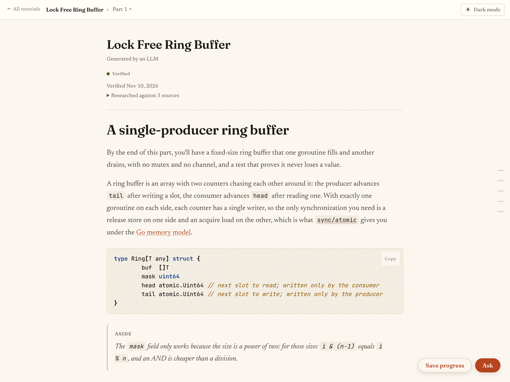
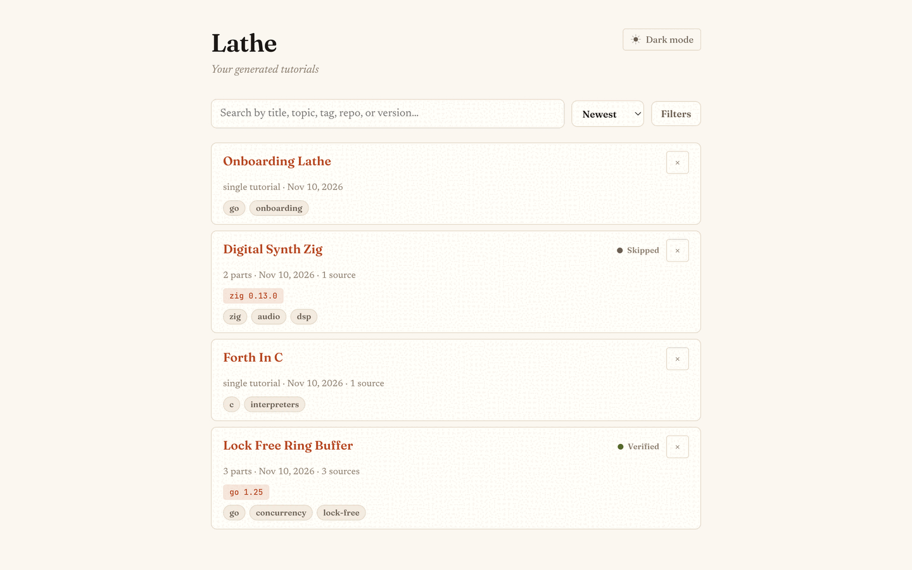

<h1 align="center">Lathe</h1>
<p align="center">Agent skills and a Go CLI that write hands-on programming tutorials for you to work through by hand in a local reader.</p>
<p align="center">
  <b>Stage:</b> beta · <b>Target:</b> personal fork, published as-is · <b>License:</b> <a href="LICENSE">MIT</a>
  <br>
  <a href="#install">Install</a> · <a href="#usage">Usage</a> · <a href="#serving">Serving</a> · <a href="AGENTS.md">Architecture</a> · <a href="https://github.com/devenjarvis/lathe">Upstream</a>
</p>

<p align="center">
  <picture>
    <source media="(prefers-color-scheme: dark)" srcset="docs/img/reading-dark.png">
    
  </picture>
</p>
<p align="center"><sub>Demo tutorial served by this checkout; regenerate with <a href="docs/img/capture.sh">docs/img/capture.sh</a>.</sub></p>

> [!WARNING]
> **Beta.** This fork has no releases, changelog or compatibility promise of its own, so you build it from `main`, and flags, metadata fields and skills can change from one commit to the next. All 384 Go test functions and the CI gate (`mage check`) pass on the current `main`, and the fork's owner runs `lathe serve` from it as a systemd service on NixOS. No exit criterion is published: upstream is at v0.5.0 and states no 1.0 criteria.

This is a fork of [devenjarvis/lathe](https://github.com/devenjarvis/lathe) that branches from upstream's v0.5.0 release. It adds onboarding guides for existing repositories with a git-based drift check, an inline corrector in the reader, `serve` flags for running behind a reverse proxy, the `principal` voice and Nix packaging. It does not carry upstream's work after v0.5.0, such as the desktop app and the hosted agent. The upstream author's account of why Lathe exists and how it handles hallucinations is in the [upstream README](https://github.com/devenjarvis/lathe#why-does-this-exist).

## Scope

- **For:** developers who learn a new domain by typing the code themselves and want an LLM to write the tutorial, then answer questions, verify and extend it, from Claude Code, Cursor, Codex, Gemini CLI, opencode, Cline, Windsurf or Antigravity.
- **Not for:** publishing tutorials to other people, which upstream rules out, or anyone who wants released binaries, the desktop app or upstream's later features; use [upstream](https://github.com/devenjarvis/lathe) for those.
- **Support:** personal fork, published as-is. Issues are disabled here, and upstream's tracker covers upstream's code, not the fork-only features.

## Install

```sh
git clone https://github.com/artmsh/lathe
cd lathe
go build -o lathe   # Go 1.25+, then put ./lathe on your PATH
```

`brew install devenjarvis/tap/lathe`, `install.sh` (this repository's copy also downloads `devenjarvis/lathe` releases) and `go install github.com/devenjarvis/lathe@latest` all install upstream v0.5.0, which has none of the fork-only features above.

<details>
<summary>Nix</summary>

`package.nix` is the derivation and `default.nix` calls it, so `nix-build` leaves the binary in `./result/bin/lathe` and `nix-shell` provides Go, mage, golangci-lint and git. Both ask for Go 1.25 (`buildGo125Module`, `go_1_25`), which nixpkgs 26.11pre has removed, so against that nixpkgs they fail to evaluate; `pkgs.callPackage ./package.nix { }` with the default Go builder evaluates there. The comments at the top of [`package.nix`](package.nix) show how a NixOS or nix-darwin configuration calls it with a pinned `rev`.

</details>

## Usage

The skills are embedded in the binary. Install them into the project where your coding agent runs; `--agent` takes `cursor`, `codex`, `gemini`, `opencode`, `cline`, `windsurf`, `antigravity` or `all`, and `--user` installs into the home directory for every agent except Cursor and Windsurf:

```sh
lathe skills install                 # Claude Code: ./.claude/skills/
lathe skills install --agent codex   # Codex: ./.agents/skills/
```

```text
Claude Code -> .claude/skills
  wrote .claude/skills/lathe/SKILL.md
  …
  wrote .claude/skills/lathe-work/SKILL.md

Installed 9 skill file(s).
```

In the agent session, ask for a tutorial, then open the reader from any terminal:

```text
/lathe build a digital synth in Zig
```

```sh
lathe serve
```

```text
Serving tutorials at http://localhost:4242
Live mode: run /lathe-work in your coding agent to drive Ask/Verify/Extend here (otherwise the buttons hand you a command to paste).
```

<p align="center"></p>

| Skill | What it does |
|---|---|
| `/lathe <topic>` | Writes a single- or multi-part tutorial, records its sources, model and voice, and stores it |
| `/lathe-onboard [path]` | Writes a guide to an existing repository whose code excerpts are anchored to files and pinned to `HEAD` |
| `/lathe-verify <slug>` | Follows a tutorial in a `mktemp -d` scratch dir, or drift-checks a guide, and records `verified`, `failed` or `skipped` |
| `/lathe-extend <slug>` | Writes the next part |
| `/lathe-ask <slug> <part>` | Answers a question about a part |
| `/lathe-correct <slug> <part>` | Applies a correction you typed against a text selection in the reader |
| `/lathe-tag <slug>` | Picks search tags |
| `/lathe-voice [name]` | Authors a custom writing voice, saved to `~/.lathe/voices/` |
| `/lathe-work` | Runs a worker loop so the reader's Ask, Verify, Add-a-part and corrector run in this session |

Without a `/lathe-work` session, Ask, Verify, Add-a-part and the corrector hand you the `/lathe-*` command to paste instead. The binary never runs a model: its only subprocesses are `git` and the browser opener, so all model work stays in your interactive agent session. Three voices ship built in (`plainspoken`, the default, plus `companion` and `principal`); `lathe voice list` and `lathe voice set-default <name>` manage them.

An onboarding guide can go stale as its repository moves on. `lathe drift <slug>` diffs the pinned commit against `HEAD` and classifies every anchored excerpt as `ok`, `moved`, `renamed`, `changed` or `broken`; `changed` or `broken` marks the guide `stale`, and `/lathe-verify` re-pins it once the prose is checked. The reader's **Check for drift** button runs the same check without an agent.

```text
routes — pinned 3b0f7570, HEAD 3b0f7570
1 ok
clean — no drift detected; status unchanged (unverified)
```

Tutorials live in `~/.lathe/tutorials/<slug>/` as `metadata.json` plus one markdown file per part; [AGENTS.md](AGENTS.md) documents the fields and status values.

## Serving

`lathe serve` binds loopback, has no authentication and exposes a delete endpoint, so widen `--bind` only behind a reverse proxy that authenticates. Requests that change state must pass a same-origin check; read-only pages stay open.

| Flag | Default | Meaning |
|---|---|---|
| `--port` | `4242` | Listen port |
| `--bind` | `127.0.0.1` | Listen address |
| `--public-origin` | none | URL the proxy serves Lathe at; with a non-loopback `--bind`, state-changing requests fail without it; implies `--no-open` |
| `--no-open` | off | Do not open a browser on start |
| `--tutorials-dir` | `~/.lathe/tutorials` | Library to serve; overrides `$LATHE_TUTORIALS_DIR`; must exist |

```sh
lathe serve --bind 0.0.0.0 --public-origin https://lathe.lan --tutorials-dir /srv/tutorials
```

## Limitations

- Upstream's author tests on Claude Code on macOS only; the other seven agent targets receive the same skills (Cursor as translated slash commands) without that testing.
- Verification runs under your agent's normal permission model. The scratch directory keeps build output out of your repository but is not a sandbox.
- `nix-build` and `nix-shell` need a nixpkgs that still provides Go 1.25 (see [Nix](#install)).

## Development

```sh
go test ./...
go vet ./...
mage check   # the CI gate: gofmt, vet, golangci-lint, go test -race, skills parity, build
```

`mage check` needs mage and golangci-lint; `nix-shell` provides both on a nixpkgs that still has Go 1.25. Skills are edited in `.claude/skills/` and mirrored into the binary with `mage skills`. [CONTRIBUTING.md](CONTRIBUTING.md) describes upstream's pull-request workflow and [AGENTS.md](AGENTS.md) the architecture.
